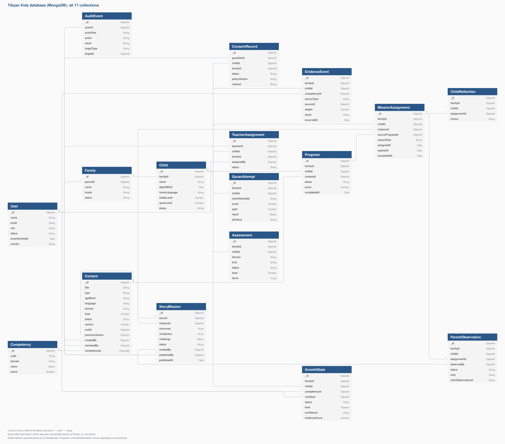
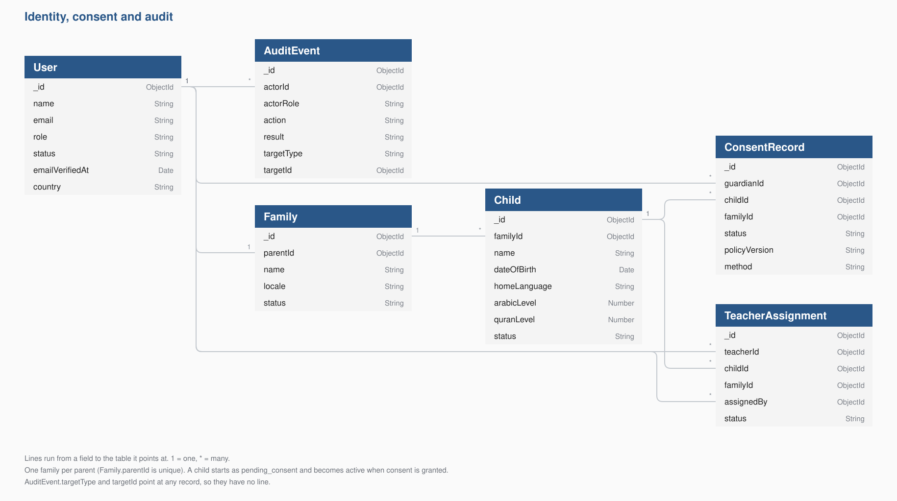
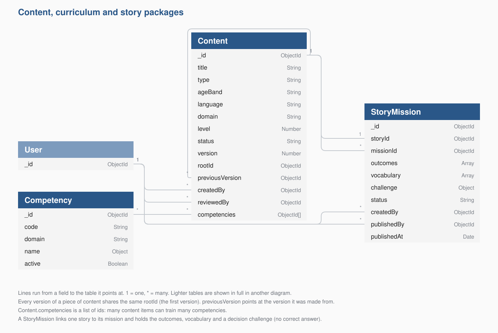
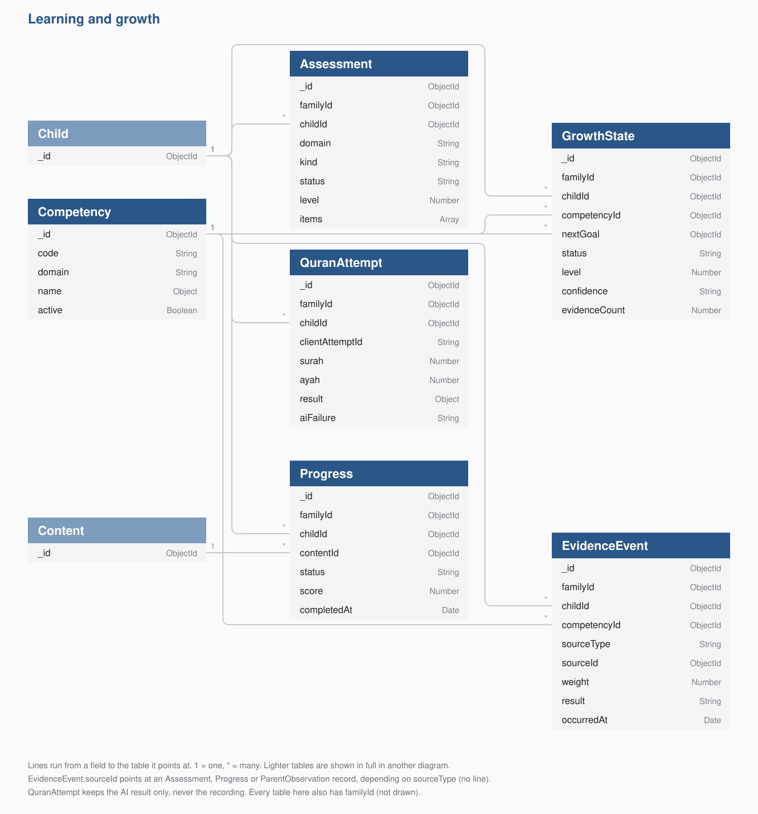
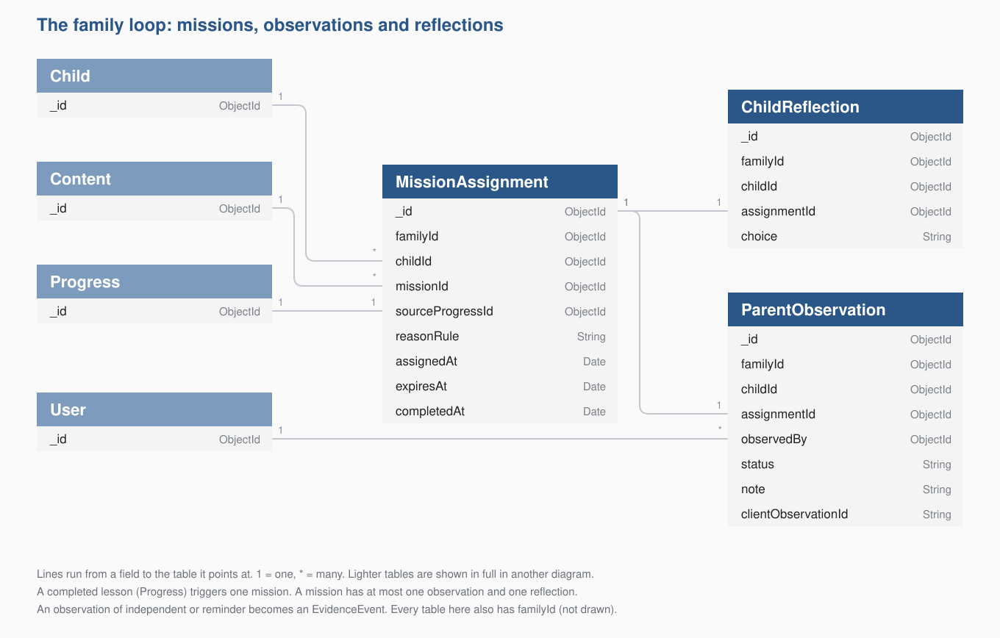

# Entity Relationship Diagram

Date: 2026-11-22
Source: the Mongoose models in `apps/api/src/Models`.

The database is MongoDB, so an arrow from one table to another is an `ObjectId` field that points at the other collection. MongoDB does not enforce it. The models and the API check it (for example, a record is refused when the child does not belong to the family).

## All 17 collections

Each line runs from a field to the table it points at. `1` means one and `*` means many. Every table that holds a child's data also has `familyId`, which points at `Family._id`. Those lines are not drawn, to keep the picture readable (SEC-002: this is how one family can never read another family's data).

The four diagrams below show the same tables in more detail. A lighter table is shown in full in another diagram.

## 1. Identity, consent and audit

- **One family per parent.** `Family.parentId` is unique. A parent can have several children.
- **Consent.** A child starts as `pending_consent` and becomes `active` when a `ConsentRecord` with status `granted` is saved. Consent records are never updated: a withdrawal is a new record.
- **Teachers.** A `TeacherAssignment` links a teacher to a child. A teacher sees only assigned children.
- **Audit.** `AuditEvent` is append-only. Its target is a type and an id with no foreign key, because it can point at any collection.

## 2. Content, curriculum and story packages

- **Versions.** Every version of a piece of content has the same `rootId` (the first version). `previousVersion` points at the one it was made from. `(rootId, version)` is unique.
- **Competencies.** A piece of content lists the competencies it trains. This is a many-to-many link stored as an array of ids.
- **Review.** Missions and Quran tasks always need a `reviewedBy` and an `approvedAt` before they can be published, and the reviewer cannot be the creator.
- **Story packages.** A `StoryMission` links one story to its family mission and holds the learning outcomes, the vocabulary and a decision challenge. `storyId` is unique: one package per story. One mission can serve several stories. The challenge stores no correct answer. See `story-missions.md`.

## 3. Learning and growth

- **Evidence is a fact.** `EvidenceEvent` is append-only. It records one piece of evidence for one competency. `sourceType` and `sourceId` say where it came from: an assessment, a completed activity (`Progress`) or a parent's observation. The same source counts once per competency. This link has no line, because `sourceId` can point at three different collections.
- **The state is derived.** `GrowthState` is recalculated from the evidence. There is one per child and competency.
- **No audio.** `QuranAttempt` keeps only the AI result, never the recording (see `audio-retention.md`).
- **Embedded data.** `Assessment.items` and `QuranAttempt.result` are stored inside their own document, not in a collection of their own.

## 4. The family loop

- **One mission per lesson.** `(childId, sourceProgressId)` is unique, so one completed lesson triggers one mission.
- **One observation and one reflection per mission.** `assignmentId` is unique in both. A repeated request with the same `clientObservationId` is recognised and not saved twice.
- **From observation to evidence.** An observation of `independent` or `reminder` becomes an `EvidenceEvent` with the lightest weight. `not_observed` creates no evidence.
- **No stored status.** A mission's status (pending, completed or expired) is worked out from `completedAt` and `expiresAt`.

## Rules the database enforces

These are unique indexes, so even a bug in the code cannot create a duplicate.

| Collection          | Unique on                                              | Why                                           |
| ------------------- | ------------------------------------------------------ | --------------------------------------------- |
| `User`              | `email`                                                | One account per email                         |
| `Family`            | `parentId`                                             | One family per parent                         |
| `Competency`        | `code`                                                 | A stable code for each competency             |
| `Content`           | `rootId` + `version`                                   | One record per version                        |
| `StoryMission`      | `storyId`                                              | One package per story                         |
| `Progress`          | `childId` + `contentId`                                | One progress record per child and content     |
| `Assessment`        | `childId` + `domain` + `kind`                          | One assessment of each kind per domain        |
| `QuranAttempt`      | `childId` + `clientAttemptId`                          | A repeated upload is the same attempt         |
| `EvidenceEvent`     | `sourceType` + `sourceId` + `competencyId`             | The same source never counts twice            |
| `GrowthState`       | `childId` + `competencyId`                             | One state per child and competency            |
| `MissionAssignment` | `childId` + `sourceProgressId`                         | One mission per completed lesson              |
| `ParentObservation` | `assignmentId`, and `familyId` + `clientObservationId` | One observation per mission, and safe retries |
| `ChildReflection`   | `assignmentId`                                         | One reflection per mission                    |
| `TeacherAssignment` | `teacherId` + `childId`                                | One assignment per teacher and child          |

## Files and how to change the diagram

- `erd/erd-*.svg` are the pictures used above. `erd/erd-*.png` are the same pictures at twice the size, for slides.
- `erd.dbml` is the source. Paste it into [dbdiagram.io](https://dbdiagram.io) to see the whole database in the same style, move tables around, and export a new image. When a model changes, update `erd.dbml` first.
- The four area diagrams were drawn from the same table list, with the tables of other areas shown as lighter stubs. If a model changes, the pictures need to be redrawn.

## Not in the diagram yet

The CRS data dictionary also lists `TeacherReview`, `TeacherSession`, `RewardEvent` and `WeeklyInsight`. They are not built, so they have no collection (see `data-dictionary.md`).
